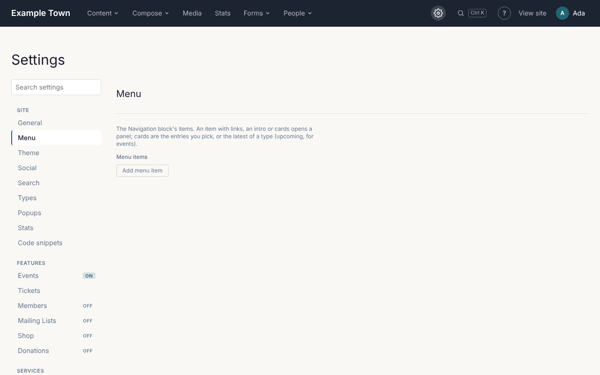

**Settings** (the gear ⚙ in the top bar) holds everything that applies to the whole site. The menu
on the left lists its sections in groups: **Site**, **Features** (each marked **On** or **Off**),
**Services**, **Admin** and **Upkeep**. On a phone, pick a section from the **Section** list at the top.

When you change something, **Save settings** appears beside the section's title. Changes take effect
when you click it. You can move between sections before saving: your changes are kept, and the site
asks before you leave Settings without saving them.

## The menu

The **Menu** section holds the links in your site's main menu.

1. Click **Add menu item**.
2. Fill in the **Label** (the words people see, such as "Visit") and the **Link** (the page's
   address, such as `/visit/`, or a full web address for another site).
3. Use **Up** and **Down** to reorder items, and **Remove** to take one out.
4. Click **Save settings**.

An item can also open a larger drop-down panel: add **Links** under a **Links heading**, a short
**Intro**, or cards showing pages or the latest posts or events.

## Every section

| Section | What it's for |
| --- | --- |
| **General** | The site's name, tagline, which page is the home page, and which page people see when an address doesn't exist. |
| **Types** | The kinds of content the site has, which layout (template) each uses, and which kinds can be marked featured (see [Kinds of content and taxonomies](/admins/content-types/)). Usually set up once. |
| **Search** | Which kinds of content the site search covers. |
| **Theme** | The site's colors, fonts, text sizes, spacing, widths and logo, and the look of these admin screens (see [The site's theme](#the-sites-theme)). |
| **Social** | Your social media profiles (shown as icons), share cards (see [Share cards](#share-cards)) and the picture used when a page without its own image is shared. |
| **Popups** | Popups over the site's pages and the cookie consent banner (see [Popups and cookie consent](/admins/popups-and-cookies/)). |
| **Stats** | Whether Stats recognises returning visitors with a cookie (see [The Stats cookie](/admins/popups-and-cookies/#the-stats-cookie)). |
| **Code snippets** | Code to put on every page: paste a tag from an analytics, chat or advertising service, or a site verification tag, into **Header**, **Body start** or **Footer**, as the service's instructions say. Paste only code from a service you trust. Tick **Only after visitors accept cookies** for tracking tags. |
| **Events**, **Tickets**, **Members**, **Mailing Lists** | Features the site can use, each turned on here (see [Turning features on](/admins/features/)). |
| **Shop** | Whether the shop is on, its currency, the unit for weights, and its checkout (see [Setting up the shop](/admins/shop/)). |
| **Connections** | Connecting Claude, card payments (Stripe or Square) and Mailgun (see [Connections](/admins/connections/)). |
| **Accessibility** | Whether publishing waits for the [accessibility check](/editors/accessibility/). |
| **Redirects** | Send visitors from an old address to a new one (see [Redirects and missing pages](/admins/redirects/)). |
| **Email log** | Keep a record of the emails the site sends (see [Email log and backups](/admins/email-log-and-backups/)). |
| **Sync** and **Backups** | Copying content between copies of the site, and backups. Usually left to whoever set up the site. |

## The site's theme

**Settings**, **Theme** sets how the site looks. A preview at the top shows text, a link and buttons
on a light background and on a dark band as you change things. Click **Save settings** to put the
changes on the site.

**Colors** are the site's palette. Each color has:

- **Color**: pick it, or type a code such as `#1a1a2e`.
- **Name**: what editors see when they choose it.
- **Dark background**: tick it for dark colors. A section with this background gets light text and
  the lighter shades below.
- **Not in the editor's choices**: hide it from the color choices in the page editor. Blocks already
  using it keep it.
- **On dark backgrounds**: the color to use in its place inside dark sections, such as a lighter blue,
  so text in it stays readable.

**Add color** adds one, and **↑** and **↓** move a color up or down the list editors choose from.
You can't remove a color that something else in the theme uses until you change that.

**What each color is for**, each one of the palette's colors or a color code:

- **Text**: body text.
- **Muted text**: dates, captions and other quiet text.
- **Accent (links, highlights)** and **Accent on hover**: links, eyebrows and buttons.
- **Button fill**: the accent when it is a button's background (optional).
- **Dark background** and **Text on dark backgrounds**: dark bands, and the text on them.
- **Text on the accent**: words on an accent-colored button.
- **Page background**, **Alternate background** and **Soft background**: light backgrounds.

**On dark backgrounds** sets what changes inside dark sections, covers and heroes: text, muted text,
accent, headings, links and buttons. Leave one at **Unchanged** to keep it as it is.

**Buttons**:

- **Background** and **Text**.
- **Background on hover** and **Text on hover**.

**Fonts**:

- **Headings**: the font for headings, quotes and big numbers.
- **Text**: the font for everything else.
- Each is one of the fonts the site comes with (serif, sans-serif and display fonts, or the device's
  own), served from the site itself.

**Text sizes** and **Spacing** list the sizes editors choose from, each a name and a size such as
`1.25rem`. Change the name or the size in place.

**Layout**:

- **Text width**: how wide text runs (such as `720px`).
- **Wide width**: how wide **Wide** blocks run (such as `1280px`).

**Logo**: an image shown by a Site title block with **Show the logo instead** on (see
[Site title](/editors/page-editor/#site-title)). **Remove logo** takes it away.

**Go back to the site's starting theme** throws away the changes made here and uses the theme the site
was built with. Click **Save settings** to keep that.

**Admin screens** sets how these admin screens and the page editor look, for everyone who signs in:

- **Match the site**: when on, they take the site's accent color, its dark background color for the menu bar,
  and its logo. Untick it to choose their own.
- **Menu bar logo**: shown in the menu bar in place of the site name, up to 32px tall. Choose one that reads on
  the menu bar's color.
- **Show the site name beside it**: the name next to the logo (on phones only the logo shows).
- **Accent**, **Text**, **Menu bar** and **Background**: each a color, or **Default**. The screen
  warns when text on a color would be hard to read.

## Share cards

When a page is shared on Facebook, LinkedIn, X, Slack or in a text message, the site sends a picture
with the link. A page whose SEO settings have no **Share image** gets a share card: a picture made from
the page's title, what kind of page it is and its featured image, with the site's name and icon.

- **Make share cards** (Settings > Social): on unless you untick it. When off, pages without a share image
  use their featured image, then the default share image.
- **Default share image**: the photo on the cards of pages without a featured image.

The site makes a card the first time someone shares the page, and makes it again when its title or
featured image changes. A page with its own **Share image** always uses that. Drafts and members-only pages
don't get a card.

## The home page

To use a different page as the home page, choose it in **Settings > General** and click **Save
settings**. The home page can't be moved to the trash while it is the home page.
