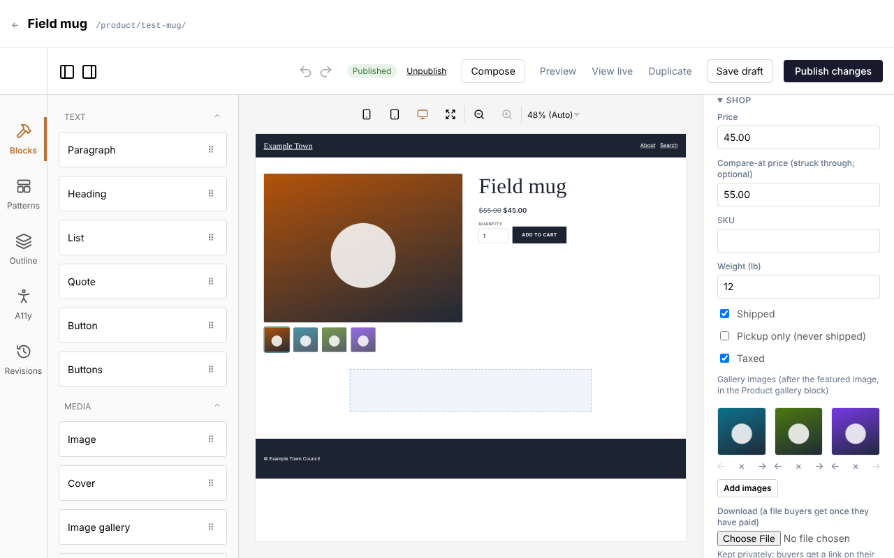
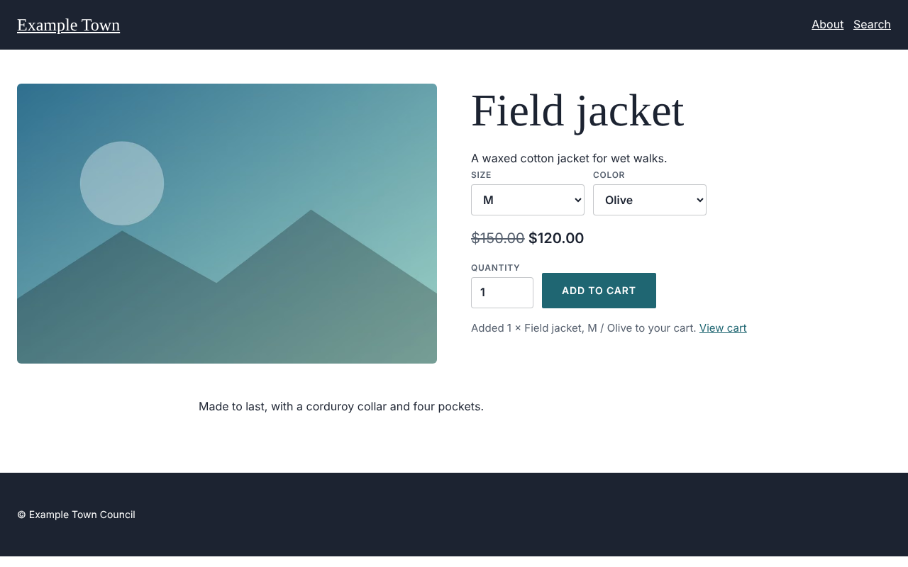
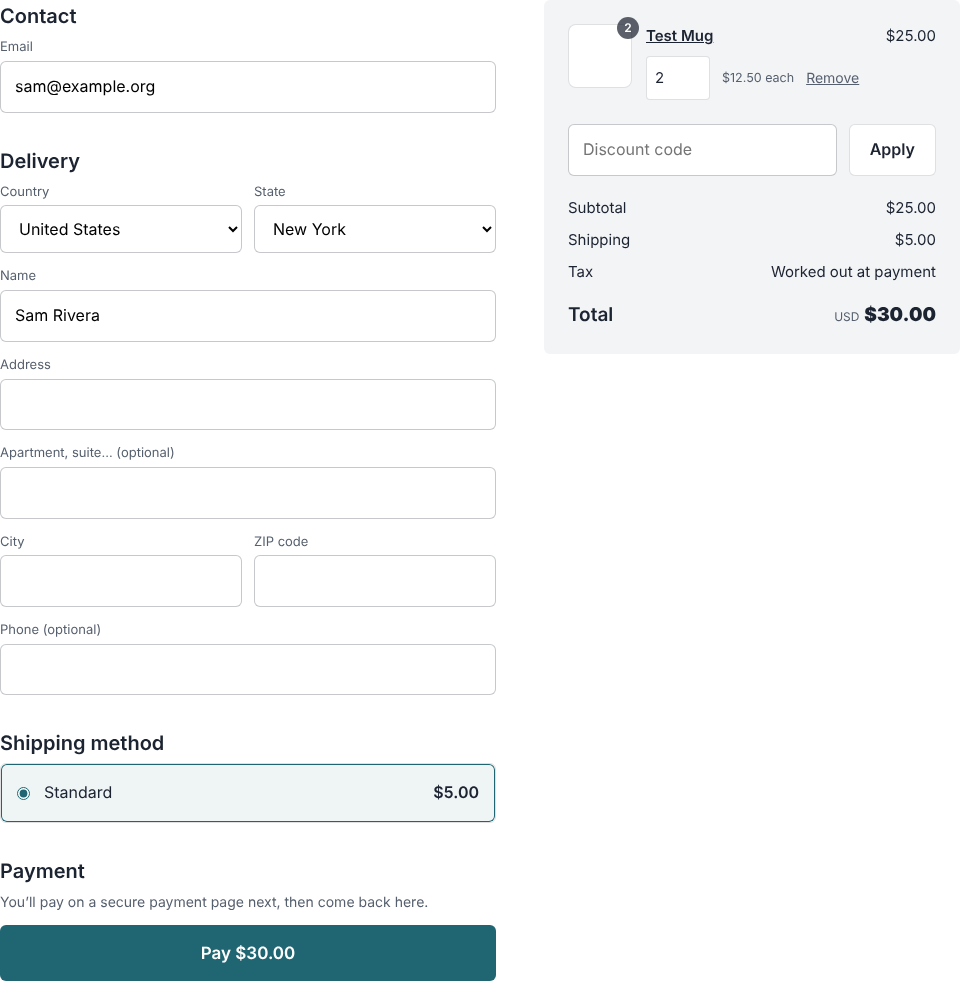
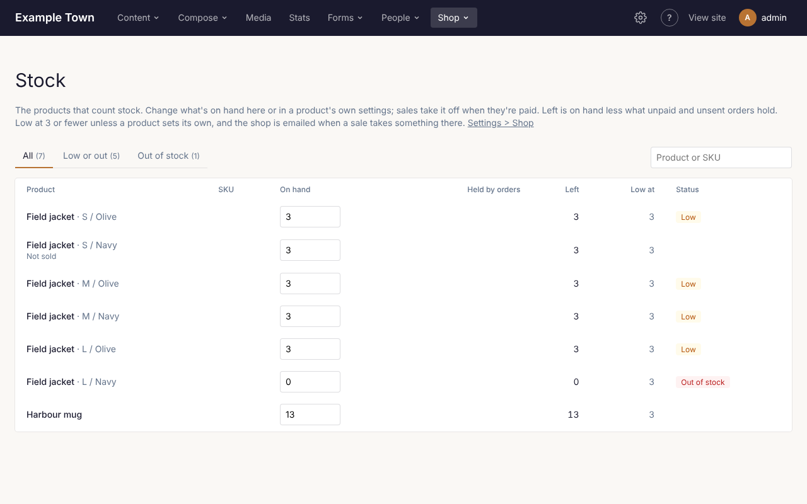
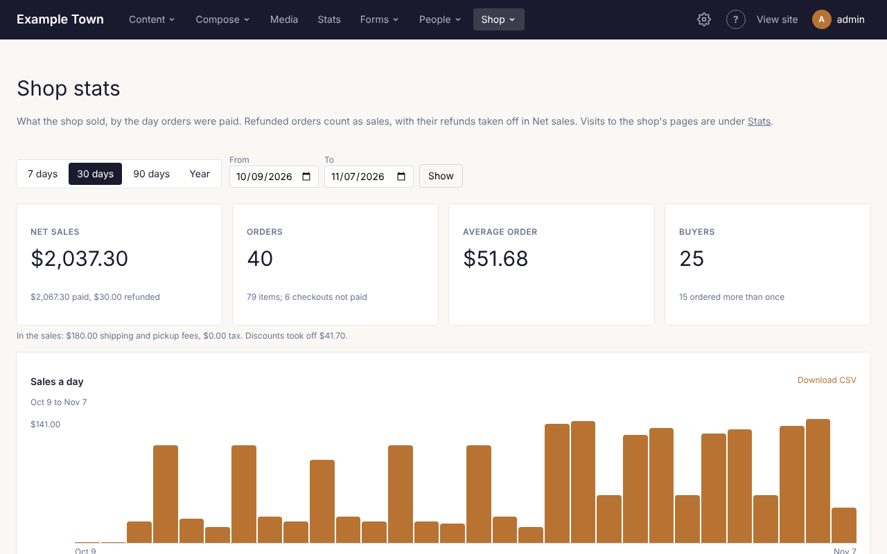

:::note[Preview]
The shop is being built. Products, options, stock, the cart and checkout (paying, shipping, pickup and
tax) and orders work now. Discount codes come next.
:::

If your site has a shop, products appear under **Content**, **Products**, and on your site at `/shop/`.
(If you don't see **Products** under **Content**, the shop is turned off; an admin can turn it on under
**Settings**, **Shop**.)

## Adding a product

1. Click **Content**, then **Products**, then **New Product**.
2. Give it a **Title** in the right-hand panel.
3. Add a **Featured image** and an **Excerpt**: they show beside the price on its page and in the shop.
4. Describe it on the page itself, as with any page.
5. Under **Shop**, give it a **Price**. Add a **Compare-at price** to show a higher price struck
   through (a sale).
6. Click **Publish**.

A product without a price isn't for sale. The other settings under **Shop**:

- **SKU** and **Weight**: for your records, and later for shipping by weight.
- **Shipped**: untick it for things nobody posts, such as a class or a gift card.
- **Pickup only**: collected, never posted.
- **Taxed**: untick it for things you don't charge tax on.
- **Most per order**: leave it empty for no limit.
- **Members** (when your site has Members turned on): for each member level, what they pay: The usual
  price, A percent off, or A price of their own. Members never pay more than the usual price.
  **Members only** limits who may buy it, with the levels that may. The product's page says what
  members save or pay and that it is for members, with a link to sign in; for anyone who isn't one of
  those members, the button says **Members only**. The cart charges signed-in
  members their price.
- A variant can have its own price for each member level too. Left empty, it uses the product's member
  pricing.

## Sizes, colors and other options

Under **Options**, click **Add an option**, name it (**Size**) and type its values with commas between
them (**S, M, L**). Add up to three options. Each combination becomes a **variant** (S / Olive,
M / Olive...), listed under **Variants**.

Open a variant to give it its own **Price**, **SKU**, **Weight** or **Image** (shown when a visitor
picks it). Left empty, it uses the product's. Tick **Not sold** for a combination that doesn't exist.
**Every variant's price** and **Every variant's stock** set them all at once.

## Carrier rates, labels and tracking

With Shippo, checkout can offer live USPS, UPS, FedEx and DHL rates, and you can buy a label on each
order's page. To set it up:

1. Make an account at Shippo and connect your carriers there (USPS comes with it).
2. Under **Settings**, **Connections**, **Shippo**, paste Shippo's API token (Settings > API in Shippo; a
   test token starts with `shippo_test_`) and click **Connect**. The site sets up Shippo's tracking
   updates itself.
3. Under **Settings**, **Shop**, **Carrier rates and labels**, fill in the settings below.
4. Give your products a weight (in their Shop settings).

The settings:

- **Offer live carrier rates at checkout**: on or off.
- **In place of the shipping zones' rates**: on, only the carriers' rates are offered; off, they're
  offered beside your own.
- **Parcels go from**: your address, as the carriers need it (a phone number helps).
- **The box**: its length, width and height, and the empty box's weight.
- **Carriers offered**: tick the ones to offer; none ticked offers every carrier on your Shippo account.

At checkout, the buyer types their ZIP or postal code and the carriers' rates appear, cheapest first.

On a paid order's page, under **Shipping**:

- **Buy a label…** lists the rates for the parcel (the buyer's choice is marked). Click one and confirm:
  Shippo charges your account, the label is ready to print (**Print the label**), and the order is marked
  shipped with its tracking number, which emails the buyer.
- Typing a tracking number yourself, choose its **Carrier** too: the buyer's email links to the
  carrier's tracking page, and with Shippo connected the parcel is followed.
- The latest tracking news shows on the order, and on the buyer's order page. **Check the tracking
  now** asks Shippo at once; otherwise it comes in by itself, and is checked hourly.
- When the carrier says the parcel was delivered, the buyer gets the **Delivered** email, once.

With a test token, labels are test labels (nothing is charged or sent) and Shippo tracks only its own
test numbers. To try tracking, mark the order shipped with one of them:

- **Tracking number**: `SHIPPO_PRE_TRANSIT`, `SHIPPO_TRANSIT`, `SHIPPO_DELIVERED`, `SHIPPO_RETURNED` or
  `SHIPPO_FAILURE`.
- **Carrier**: Shippo test numbers (offered only while the token is a test one).

A test label's own tracking number can't be checked: **Check the tracking now** says so, and the hourly
check leaves it out.

## Downloads

A product can be a file buyers download: an e-book, a pattern, a print-at-home ticket.

1. In the product's Shop settings, under **Download**, choose the file. It uploads at once (up to 200 MB;
   on Cloudflare's Free and Pro plans, up to 100 MB).
2. Turn off **Shipped** if there's nothing to post.
3. Save the product.

Once an order is paid, its page and its confirmation email have a link for each file. The file is kept
privately: only those links reach it. Under **Settings**, **Shop**, **Downloads**:

- **Times a buyer can download each file**: 5 to begin with; 0 for no limit.
- **Days after paying a download works**: 30 to begin with; 0 for always.

An order's page shows how many times each file was downloaded. Changing a product's file later doesn't
change what earlier orders get. Download files aren't copied by Sync or kept in backups.

## Stock

Tick **Count stock** to keep count of what you have. Type how many are **In stock** (on each variant,
when the product has options). Stock saves as soon as you leave the box, without saving the product:
nobody's other changes to the product can overwrite it. Leave **Count stock** unticked for no limit.

On the site, what has run out says **Sold out** and can't be added to the cart.

## On the site

A product's page shows its options, price and **Add to cart**.

The cart is at `/cart/`. Visitors change quantities or remove things there; it never takes more than
you have in stock.

## Product categories

Products come with **Product categories**, a taxonomy of their own: tick a product's categories in its
settings, and manage them under **Content**, **Taxonomies**, **Product categories**. Categories can sit
under other categories. Each has its own page at `/shop/category/<address>/`, listing its products,
and the shop at `/shop/` has filters by category.

When your site has Members turned on, a category can take a percent off for members:

1. Click **Content**, then **Taxonomies**, then **Product categories**.
2. Click **Details** beside the category.
3. Under **Member pricing**, type the percent off for each member level.
4. Click **Save**.

The discount applies to every product in the category and in the categories under it. A product's own
member pricing comes first; a product in several categories takes the largest discount.

## Checkout

The cart page is the checkout: the form on the left, and on the right the order summary (each item with
its picture, quantity and price, a discount code and the totals). On a phone the summary is folded behind
**Show order summary**, with the total.

1. Under **Contact**, they give their email, and can tick **Email me news and offers** when you offer it.
2. Under **Delivery**, they choose their country (and state, in the US), then give their name, their
   address when the order is posted, and, if they like, a phone number.
3. Under **Shipping method**, they choose one of your shipping rates for their country, or a pickup
   location. Only rates that fit their order are offered.
4. If they have a discount code, they type it in the summary and click **Apply**.
5. They check the discount, shipping, tax and total in the summary, and click **Pay**. Payment is on
   Stripe's or Square's own page.
6. They come back to a page with their order, and get a receipt by email.

Each order is emailed to the site's admin address too (or the address set as `SHOP_NOTIFY_EMAIL`), and
listed under **Orders**. The emails can be changed under **Settings**, **Shop** (see Emails below).

What someone is paying for is put aside while they pay, so two people can't buy the last one. If they
don't pay within the time set under **Settings**, **Shop**, it goes back on sale. Stock comes off the
count once an order is paid.

An order with nothing to pay (everything free) is placed at once, without the payment page.

## Orders

Click **Shop** in the admin bar (it shows while the shop is on), then **Orders**. The tabs:

- **To send or hand over**: paid orders still to ship or to be picked up.
- **Paid**, **Awaiting payment**, **Cancelled and expired**, **Refunded** and **All orders**.

Search by order number, email or name. **Export CSV** downloads the orders shown, a row for each item.

Click an order to see what was bought, the totals, the buyer, where it goes and the payment. On its page:

- **Mark shipped and email the buyer**: type the tracking number first, if there is one. The buyer gets an
  email saying it is on its way.
- **Mark picked up**: for an order collected from a pickup location.
- **Notes**: for the shop only; the buyer never sees them.
- **Resend confirmation**: emails the buyer their receipt again.
- **Refund** (admins): type how much to give back, all or part. The money goes back to their card through
  Stripe or Square, and the buyer gets an email saying how much. Refunding all of it marks the order
  refunded.
- **Cancel order**: for an order that wasn't paid for, or one with nothing left to pay back (free, or
  refunded in full).
- **Put back in stock**: for each item, how many go back on the shelf. Fill these in before you refund or
  cancel and they go back at the same time, or use **Put back in stock only**. An item can't go back more
  times than it was bought.

A refund made in Stripe's or Square's own dashboard shows on the order too, but puts nothing back in
stock: do that on the order's page.

## Discounts

Click **Shop** in the admin bar, then **Discounts**. The list shows each discount's code (or Automatic),
what it gives, its dates, how many paid orders used it, their sales, how much it took off, and whether it
is running.

Click **New discount**, or a discount to change it. Its settings:

- **Automatic**: on, it has no code and applies by itself to orders it fits; off, buyers type its code.
- **Code**: letters and numbers, such as SUMMER10. Buyers can type it in small letters.
- **Name**: shown in the cart. Empty: the code.
- **It gives**: a percent off, an amount off, or free shipping.
- **On**: the whole order, some products, or some product categories (and the categories under them).
- **Only on orders of at least**: a smallest order. Empty: any.
- **Starts** and **Ends**: empty, it starts now and never ends.
- **Uses in all**: how many orders may use it. Empty: no limit.
- **Once per email address**: each buyer uses it once.
- **Members only** (while Members is on): and, with several levels, which levels may use it.
- **On**: off, nobody can use it.

Click **Make discount** or **Save discount**. **Delete** removes it; orders that used it keep its code.

An order takes one discount: the code the buyer typed, if the order fits it, else the automatic discount
that saves the most. A code that doesn't fit says why (too small an order, expired, used up, members
only). Uses count paid orders and orders waiting to be paid, so the last use can't be taken twice.

The discount is shared out over the items it applies to, and tax is worked out after it. A refund gives
back what was paid, after the discount.

## Stock

Click **Shop** in the admin bar, then **Stock**, for every product that counts stock, each size or
color on its own line.

- **On hand**: type a new count and press Enter (or click away); it saves at once.
- **Held by orders**: what orders waiting to be paid, or paid and not yet taken off, are keeping.
- **Left**: on hand less what's held, what can still be sold.
- **Low at**: the product's own mark, or the shop's.
- **Status**: **Low** at or under the mark, **Out of stock** at none.

**Low or out** and **Out of stock** show just those; the box searches by name or SKU.

The low-stock mark is set under **Settings**, **Shop**, **Stock**:

- **Low stock at**: how few left counts as low (3 to begin with; 0 for never).
- **Email the shop when a sale takes something to low stock**: on or off. Each one is emailed about once,
  until you raise its count again.

A product can have its own mark: **Low stock at** in its Shop settings, under **Count stock**.

## Shop stats

Click **Shop** in the admin bar, then **Stats**, for what the shop sold. Choose **7 days**, **30 days**,
**90 days** or **Year**, or pick dates and click **Show**. Orders count on the day they were paid.

- **Net sales**: what buyers paid, less what was refunded.
- **Orders**: paid orders, the items in them, and checkouts started but never paid.
- **Average order** and **Buyers** (and how many ordered more than once).
- **Sales a day** (a week, for longer ranges); **Show as a table** lists them.
- **Products that sold most**, **Discounts used** and **How orders were sent**.
- **Campaigns**: sales from visits that came by a campaign link (see **Making a campaign link** in the
  Stats guide), such as a newsletter or an advert. An order's page shows its campaign too. While a cookie
  banner is on, only visitors who accept cookies are counted here.

**Download CSV** beside a table downloads it. Visits to the shop's pages are under **Stats** in the
admin bar.

## Blocks for the shop

In the page editor, under **Shop**:

- **Add to cart**: on a product's page it sells that product; anywhere else, choose one in its settings.
- **Product price**: the price, or "From" the lowest when variants differ.
- **Cart**: the cart itself. Your `/cart/` page shows it on its own; a page you make with that address
  needs this block.
- **Cart link**: a link to the cart with the number of things in it, for the header.

Collections can show products with the **Product: image, name and price** card.

## Turning the shop on

**Settings**, **Shop** (admins): tick **Shop on**, choose the **Currency** and the unit **Weights** are
in, and click **Save settings**. Turning it on the first time adds three templates under **Templates**:
**Product** (a product's page), **Shop** (the `/shop/` listing) and **Product category** (a category's
page). Change them like any template.
Turning the shop off deletes nothing; products are hidden until it is on again.

While the shop is on, the same screen sets up checkout.

**Payments**:

- **Payments go through**: Stripe or Square, when both are connected under **Settings**, **Connections**.
- **Minutes an unpaid order holds its stock**: 30 to 120 (60 if left empty).

**Shipping**: click **Add a shipping zone**, name it, and add the places it covers (a country, a US
state, or **Everywhere else**). Zones are checked in order: the first that names the buyer's country or
state gives its rates, and **Everywhere else** is used only when no zone names it. Without it, other
addresses can't be shipped to. Each zone's rates:

- **Name**: what the buyer sees, such as Standard or Express.
- **Price**: One price, By the order's subtotal, or By the order's weight. By subtotal or weight, add
  bands, each with a **From**, an **Up to** (empty: no limit) and a **Price**. An order that falls in no
  band isn't offered the rate.
- **Free when the subtotal is at least**: leave empty for never.

**Pickup**: click **Add a pickup location** for each place buyers can collect from:

- **Name**, **Address** and **Hours**: shown to the buyer.
- **Fee**: empty for free.
- **Where it is, for tax**: the country or state whose tax rate applies.

**Tax**:

- **Tax is**: Worked out from the rates here, or Worked out by Stripe Tax (only when payments go through
  Stripe; turn Stripe Tax on in Stripe first). Until Stripe Tax is active, Stripe refuses every checkout
  and buyers can't pay: the setting shows a warning saying so, and what Stripe still needs (such as your
  business address, in Stripe's dashboard under Settings > Tax).
- **Store's tax rate (%)**: used where no other rate applies.
- **Rates for places**: a rate for a country or US state, replacing the store's. A state's rate wins
  over its country's.
- **Tax shipping too**: on or off.

Each product's **Taxed** switch decides whether it is taxed. The shop adds the tax you set up; it
doesn't register for or file tax for you.

**Email me news** (while Mailing Lists is on): tick the mailing lists a box at checkout signs buyers
up to, and change its words if you like. The box starts unticked. A buyer who ticks it gets an email to
confirm, as with a Subscribe block, and is on the lists only once they do. With no list ticked here,
checkout has no box.

**Emails**: the emails an order sends, each with a **Subject** and **Edit email**, which opens the email
builder:

- **Order confirmation**: to the buyer when the order is paid.
- **Shipped**: to the buyer when you mark the order shipped, with its tracking number.
- **Delivered**: to the buyer when the carrier says the parcel arrived (with Shippo connected).
- **Refunded**: to the buyer when you refund the order on its page, all or part.
- **Copy to the shop**: each paid order, to the shop. **Send the shop a copy of each order** turns it off.

In the builder, the **Order details** block shows the order (what was bought and the totals), or one part
of it: the items, the totals, where it goes, the order number, the tracking number, the refund or the
buyer's details. Merge tags such as `{first_name}`, `{code}`, `{total}` and `{tracking}` fill in the
order's details; the builder lists them all. **Preview** shows the email with a sample order.
**Templates** saves a design to start others from; a template set as the default for one of these emails
is sent until you design your own here. **Reset to the default** goes back to it.
