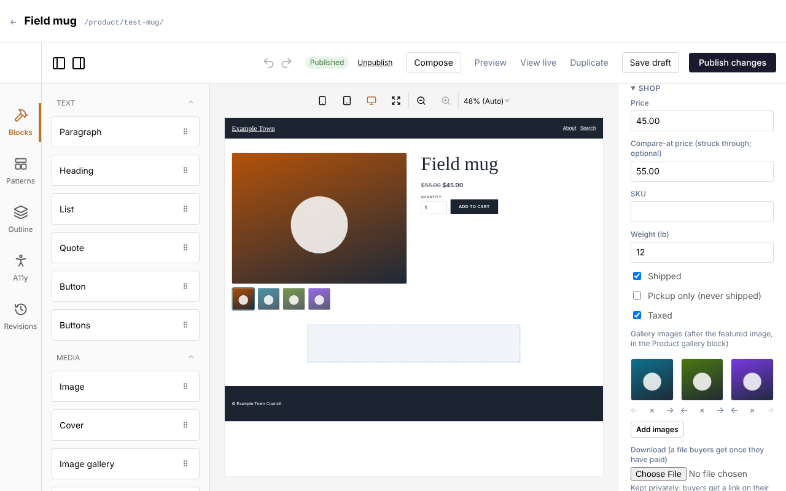
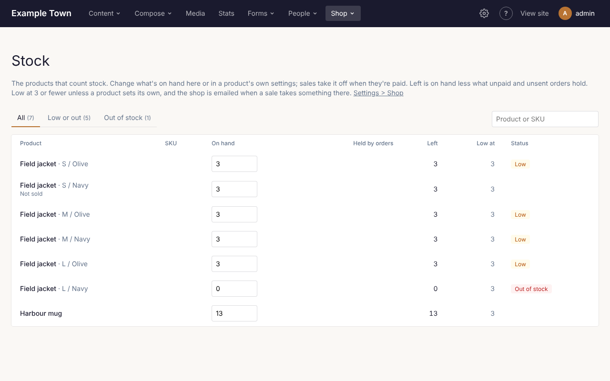
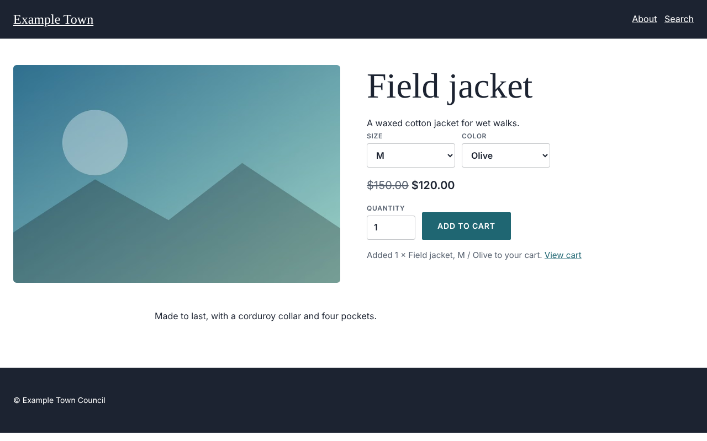
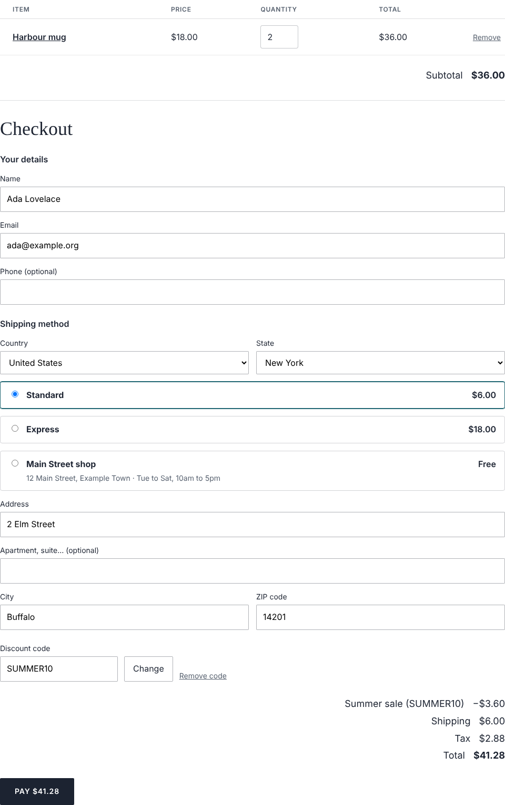
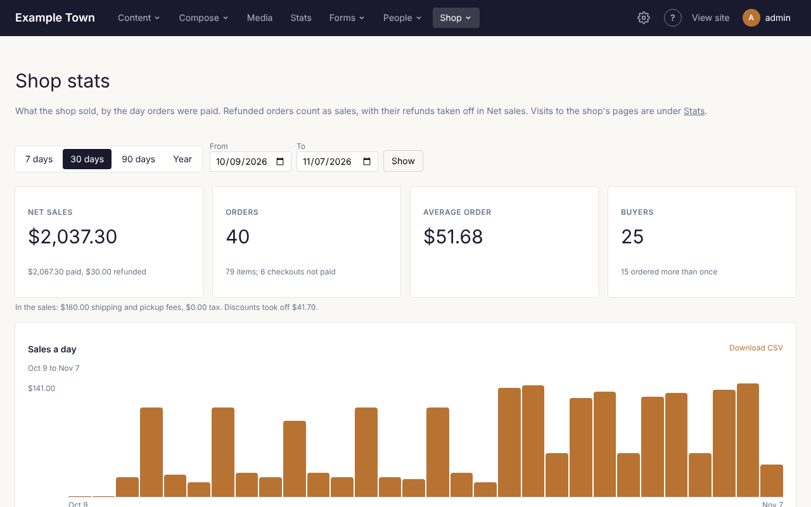

If your site has a shop, products appear under **Content**, **Products**, and on your site at `/shop/`.
**Shop** in the admin bar has **Orders**, **Discounts**, **Stock** and **Stats**. If you don't see them,
the shop is turned off; an admin can turn it on under **Settings**, **Shop**.

How buyers pay, shipping, pickup, tax, the order emails and your own order statuses are set up by an
admin: see [Setting up the shop](/admins/shop/).

## Adding a product

1. Click **Content**, then **Products**, then **New Product**.
2. Give it a **Title** in the right-hand panel.
3. Add a **Featured image** and an **Excerpt**: they show beside the price on its page and in the shop.
4. Describe it on the page itself, as with any page.
5. Under **Shop**, give it a **Price**. Add a **Compare-at price** to show a higher price struck
   through, or put it **On sale** (see Sales below).
6. Click **Publish**.

A product without a price isn't for sale. Its other settings:

- **Featured** (with its details): mark the products to feature. A Collection block can show featured
  ones only.
- **Gallery images** (under **Shop**): more pictures of it, shown after its featured image by the
  **Product gallery** block. Click **Add images** and choose one or more from the media library; the
  arrows under a picture move it earlier or later, and **×** takes it out.
- **SKU** and **Weight**: for your records, and for shipping by weight.
- **Shipped**: untick it for things nobody posts, such as a class or a gift card.
- **Pickup only**: collected, never posted.
- **Taxed**: untick it for things you don't charge tax on.
- **Most per order**: leave it empty for no limit.
- **Members** (when your site has Members turned on): for each member level, what they pay: The usual
  price, A percent off, or A price of their own. Members never pay more than the usual price.
  **Members only** limits who may buy it, with the levels that may. The product's page says what
  members save or pay, with a link to sign in; for anyone who isn't one of those members, the button
  says **Members only**.

## Sizes, colors and other options

Under **Options**, click **Add an option**, name it (**Size**) and type its values with commas between
them (**S, M, L**). Add up to three options. Each combination becomes a **variant** (S / Olive,
M / Olive...), listed under **Variants**.

Open a variant to give it its own **Price**, **SKU**, **Weight** or **Image** (shown when a visitor
picks it, in the Product gallery too). Left empty, it uses the product's. Tick **Not sold** for a
combination that doesn't exist. **Every variant's price** and **Every variant's stock** set them all at
once. A variant can have its own price for each member level too.

## Sales

Under **Shop**, tick **On sale**, then set:

- **Starts**: a date and time, or empty for now.
- **Ends**: a date and time, or empty to run until you untick **On sale**.
- **Sale price**: A price (every variant's), or A percent off each variant's price.
- **Members pay in the sale** (for each member level, when your site has Members turned on): Their usual
  price, or the sale price when lower; A percent off the usual price; or A sale price of their own.

While the sale runs, the product's page and cards show the sale price with the usual price struck through
and a **Sale** mark, and the cart charges it. Members pay the lowest of their member price, their sale
price and the sale price. A sale price that isn't lower than the usual price isn't used. A variant can
have its own **Sale price**. Pages can take a minute or two to show a sale starting or ending; the cart
always charges the price at that moment.

## Stock

Tick **Count stock** to keep count of what you have, and type how many are **In stock** (on each variant,
when the product has options). Stock saves as soon as you leave the box, without saving the product, so
nobody's other changes to the product can overwrite it. Leave **Count stock** unticked for no limit.
**Low stock at** sets this product's own low-stock mark.

On the site, what has run out says **Sold out** and can't be added to the cart. Stock comes off the
count once an order is paid; while someone is paying, what they're buying is put aside, so two people
can't buy the last one.

**Shop**, then **Stock**, in the admin bar lists every product that counts stock, each size or color on
its own line:

- **On hand**: type a new count and press Enter (or click away); it saves at once.
- **Held by orders**: what orders waiting to be paid, or paid and not yet taken off, are keeping.
- **Left**: on hand less what's held, what can still be sold.
- **Low at**: the product's own mark, or the shop's.
- **Status**: **Low** at or under the mark, **Out of stock** at none.

**Low or out** and **Out of stock** show just those; the box searches by name or SKU.

## Downloads

A product can be a file buyers download: an e-book, a pattern, a print-at-home ticket.

1. In the product's Shop settings, under **Download**, choose the file. It uploads at once (up to 200 MB;
   on Cloudflare's Free and Pro plans, up to 100 MB).
2. Turn off **Shipped** if there's nothing to post.
3. Save the product.

Once an order is paid, its page and its confirmation email have a link for each file; only those links
reach it. How many times and for how long a link works is set by an admin. Changing a product's file
later doesn't change what earlier orders get.

## Product categories

Tick a product's **Product categories** in its settings, and manage them under **Content**,
**Taxonomies**, **Product categories**. Categories can sit under other categories. Each has its own page
at `/shop/category/<address>/`, and the shop at `/shop/` has filters by category.

When your site has Members turned on, a category can take a percent off for members: click **Details**
beside it, type the percent off for each member level under **Member pricing**, and click **Save**. It
applies to every product in the category and the categories under it. A product's own member pricing
comes first; a product in several categories takes the largest discount.

## Showing products on your pages

A product's own page shows its pictures, options, price and **Add to cart**:

On any page, under **Shop** in the page editor's blocks (each described in
[the list of blocks](/editors/page-editor/#shop)):

- **Product**: one product, with its picture, name, price and Add to cart.
- **Add to cart**, **Product price** and **Product gallery**: parts of a product, for a product's page or
  template, or for one product you choose anywhere.
- **Cart** and **Cart link**: the cart, and a link to it with the number of things in it, for the
  header.

To list several products, add a **Collection** block, tick **Products**, and choose the **Product: image,
name and price** card. Tick **Featured only** to show just the products marked Featured.

## How buyers check out

The cart, at `/cart/`, is the checkout: the form on the left, and on the right the order summary (each
item with its picture, quantity and price, a discount code and the totals). On a phone the summary is
folded behind **Show order summary**.

1. Under **Contact**, they give their email, and can tick **Email me news and offers** when it is offered.
2. Under **Delivery**, they choose their country (and state, in the US), then give their name, their
   address when the order is posted, and a phone number if they like.
3. Under **Shipping method**, they choose a shipping rate or a pickup location.
4. If they have a discount code, they type it in the summary and click **Apply**.
5. They click **Pay**, and pay on Stripe's or Square's own page.
6. They come back to a page with their order, and get a receipt by email.

Each paid order is emailed to the shop too, and listed under **Orders**.

## Orders

Click **Shop** in the admin bar, then **Orders**. The tabs:

- **To send or hand over**: paid orders still to ship or to be picked up.
- **Paid**, **Awaiting payment**, **Cancelled and expired**, **Refunded** and **All orders**.

Search by order number, email or name, and choose a status under **Any status** to see only those
orders. **Export CSV** downloads the orders shown, a row for each item.

Click an order to see what was bought, the totals, the buyer, where it goes and the payment. On its page:

- **Mark shipped and email the buyer**: type the tracking number first, if there is one, and choose its
  **Carrier**. The buyer gets an email saying it is on its way, linking to the carrier's tracking.
- **Buy a label…** (when your site is connected to Shippo): lists the carriers' rates for the parcel,
  the buyer's choice marked. Click one and confirm: the label is ready to print (**Print the label**)
  and the order is marked shipped. The latest tracking news shows on the order; **Check the tracking
  now** asks at once. When the parcel is delivered, the buyer gets an email.
- **Mark picked up**: for an order collected from a pickup location.
- **Status** (when your shop has order statuses, such as Being made or Ready to collect): choose one and
  click **Set status**. A status that emails the buyer shows **Email the buyer**, ticked; untick it to
  change the status without the email.
- **Notes and history**: type a note and click **Add note**; notes are for the shop only, and the buyer
  never sees them. Below, everything that happened to the order, newest first, with when and who: placed,
  paid, every email sent (its subject and who it went to, or why it wasn't sent), shipped or picked up,
  labels, delivered, refunds, items put back in stock, status changes, cancelled or expired, and the
  notes.
- **Resend confirmation**: emails the buyer their receipt again.
- **Refund** (admins only): gives back all or part of what was paid, to their card.
- **Cancel order**: for an order that wasn't paid for, or one with nothing left to pay back (free, or
  refunded in full).
- **Put back in stock**: for each item, how many go back on the shelf. Fill these in before a refund or
  cancel and they go back at the same time, or use **Put back in stock only**. An item can't go back more
  times than it was bought.

## Discounts

Click **Shop** in the admin bar, then **Discounts**. The list shows each discount's code (or Automatic),
what it gives, its dates, how many paid orders used it, their sales, how much it took off, and whether it
is running.

Click **New discount**, or a discount to change it. Its settings:

- **Automatic**: on, it has no code and applies by itself to orders it fits; off, buyers type its code.
- **Code**: letters and numbers, such as SUMMER10. Buyers can type it in small letters.
- **Name**: shown in the cart. Empty: the code.
- **It gives**: a percent off, an amount off, or free shipping.
- **On**: the whole order, some products, or some product categories (and the categories under them).
- **Only on orders of at least**: a smallest order. Empty: any.
- **Starts** and **Ends**: empty, it starts now and never ends.
- **Uses in all**: how many orders may use it. Empty: no limit.
- **Once per email address**: each buyer uses it once.
- **Members only** (while Members is on): and, with several levels, which levels may use it.
- **On**: off, nobody can use it.

Click **Make discount** or **Save discount**. **Delete** removes it; orders that used it keep its code.

An order takes one discount: the code the buyer typed, if the order fits it, else the automatic discount
that saves the most. A code that doesn't fit says why (too small an order, expired, used up, members
only). The discount is shared out over the items it applies to, and tax is worked out after it.

## Shop stats

Click **Shop** in the admin bar, then **Stats**, for what the shop sold. Choose **7 days**, **30 days**,
**90 days** or **Year**, or pick dates and click **Show**. Orders count on the day they were paid.

- **Net sales**: what buyers paid, less what was refunded.
- **Orders**: paid orders, the items in them, and checkouts started but never paid.
- **Average order** and **Buyers** (and how many ordered more than once).
- **Sales a day** (a week, for longer ranges); **Show as a table** lists them.
- **Products that sold most**, **Discounts used** and **How orders were sent**.
- **Campaigns**: sales from visits that came by a campaign link (see
  [Making a campaign link](/editors/stats/)), such as a newsletter or an advert. An order's page shows its
  campaign too.

**Download CSV** beside a table downloads it. Visits to the shop's pages are under **Stats** in the
admin bar.
